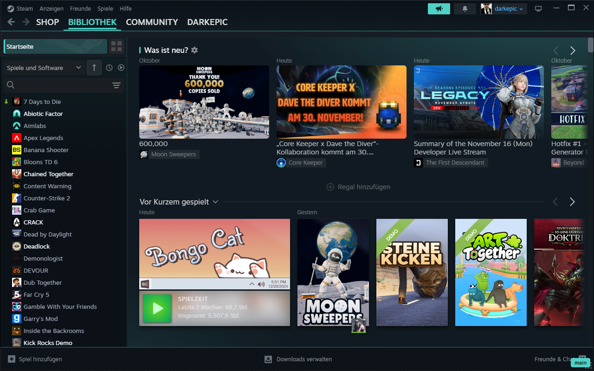

<h1 align="center">Test Theme</h1>

<p align="center">A dark reference theme for LYTE that styles all 12 window targets, with colors, a slider, a select, toggles and a bundled image you can change in Settings.</p>

<p align="center"></p>

## What it styles

Every window target that LYTE supports has its own stylesheet, including shared desktop styling across Steam client windows.

| Window | File | What changes |
| --- | --- | --- |
| All windows | `css/all.css` | Selection highlight, focus outlines, custom scrollbars and the optional window label |
| Desktop windows | `css/desktop.css` | Shared Steam client buttons, dialog controls and header typography (excludes Store, Community and Web) |
| Main window | `css/main.css` | Top bar, navigation, sidebar, search box, game list, section headers, home shelves, game details, downloads and bottom bar with texture |
| Settings | `css/settings.css` | Page list gradient, active item accent bar, title color and content column |
| Friends | `css/friends.css` | Friends list, tabs, chat rooms, chat hover rows and friend hover popups |
| Overlay | `css/overlay.css` | Accent frame, translucent overlay panels, browser, notes, screenshots and timeline bar |
| Menus | `css/menus.css` | Menu popups, rounded items, active highlight and separators |
| Notifications | `css/notifications.css` | Accent-bordered toast cards, gradient background and notification typography |
| Dialogs | `css/dialogs.css` | Modal frames, headers, add-game and properties surfaces and bottom button row |
| Store | `css/store.css` | Store header, body surface, rounded capsules, active row bar, discount badge and footer |
| Community | `css/community.css` | Community header, hub and workshop cards, market rows and footer |
| Web pages | `css/web.css` | Support page panels, wizard buttons, selection highlight and footer |

## Options

Open **Settings**, then **LYTE**, then **Themes**, and select **Options** on the theme.

| Option | Type | What it does |
| --- | --- | --- |
| Accent color | Color | Highlights, active indicators and focus outlines |
| Surface color | Color | Main pages, dialog content and store/community/web background |
| Bar color | Color | Top bar, sidebars, menus, bottom bar and web headers |
| Card color | Color | Shelves, dialogs, toast cards and game info panels |
| Corner radius | Slider, 0 to 12 px | Cards, buttons, inputs and menus |
| Navigation size | Select | Compact, regular or roomy navigation text |
| Ambient glow | Toggle | Soft accent highlight behind the Library home and game header |
| Bottom bar texture | Toggle | Optional pattern overlay on the bottom bar (`off` by default) |
| Window labels | Toggle | Prints the window target in the lower right corner of every window |

Turn on **Window labels** to check that a style file reached the window you expect.

## Use options in your own theme

Every option becomes a CSS variable named after its id. Toggles and selects also set an attribute on the root element.

```css
.steam-SuperNav--Selected {
  box-shadow: inset 0 -2px 0 var(--accent, #4fd1c5);
}

html[data-theme-density="compact"] .steam-SuperNav {
  font-size: 12px;
}
```

The option itself is declared in `lyte.theme.json`:

```json
{
  "id": "accent",
  "type": "color",
  "label": "Accent color",
  "group": "Colors",
  "default": "#4fd1c5"
}
```

> Steam changes its class names often. Write `.steam-Name` and LYTE swaps in the current class for you.

## Install

Install it from the LYTE catalog, or download the repository and use **Import folder** on the Themes page.

## License

MIT
